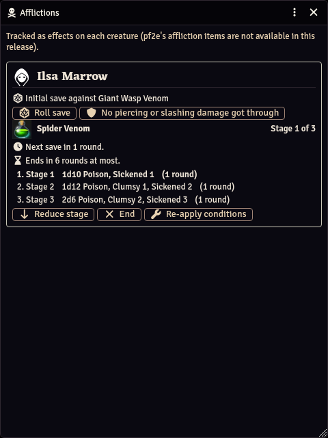
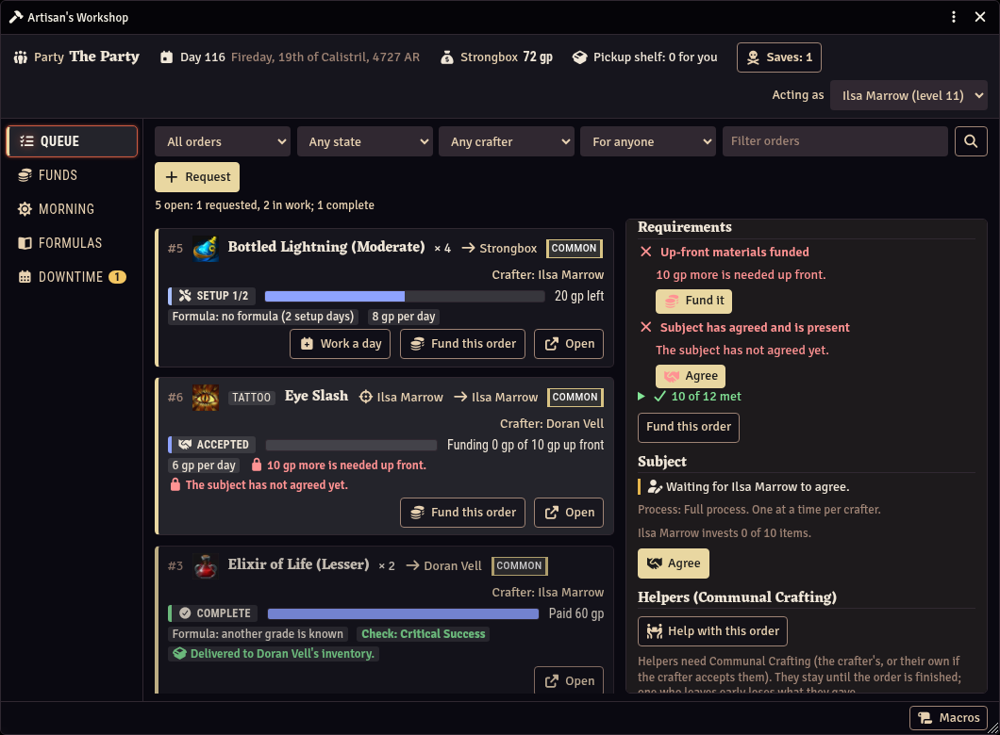
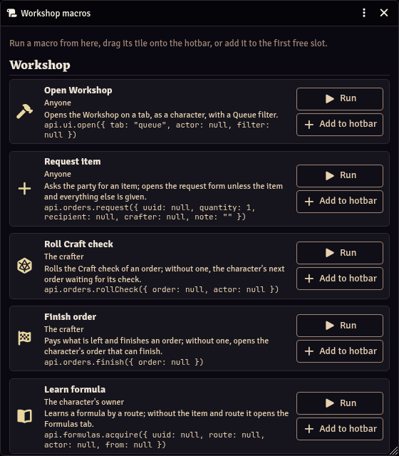
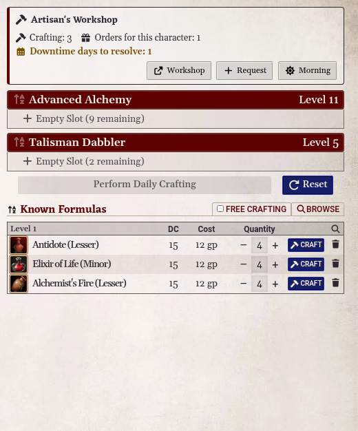

# Artisan's Workshop (PF2e)

A Foundry VTT module for the Pathfinder Second Edition system: one place to run an
alchemist or crafter, and the party that leans on them.

**Status: early development.** Nothing installable yet: the repository has the M0
scaffold (manifest, tooling, CI), the M1 rules core (pure crafting and Earn Income
rules with tests), the M2 storage and sync layer (the shared ledger and strongbox,
safe coin moves, claims, roster snapshots, purge) and the M3 rules registry and roll
wrapper (Craft and Earn Income checks rolled with the item's options and recorded once,
rerolls included), and the M4 Workshop window: the Queue and Funds tabs, the order lifecycle
from request to delivery, escrow and refunds, chat cards and the request form. Open it from
the "Workshop" button in the Actors directory or on the Party sheet, or with
`game.modules.get("pf2e-artisans-workshop").api.ui.open()`. The
specification is `DESIGN.md`; decisions land in `DECISIONS.md`.

## What it is for

- **A party crafting queue.** Party members request items; the crafter sees what
  is wanted, which formulas they have (and how they could get the missing ones),
  the materials and days each item needs, and how far along each one is. Everyone
  sees the queue and a progress bar per item.
- **Shared funding.** Party members put gold toward an item's materials, and the
  ledger remembers who paid for what.
- **Daily preparations.** Advanced Alchemy, talismans and other daily items, built
  to work alongside the PF2e system and pf2e-dailies rather than against them.
- **Rules coverage.** Feats, class features and gear that change crafting cost,
  time, batches or formulas are read from the character, not entered by hand.
- **Downtime.** Earn Income with Crafting, Cooking Lore or any other skill, paid
  straight to the earner; GMs set settlement task levels. Nothing waits on GM
  approval, and it works with no GM online.

Alchemy is the first crafting journey, not the only one: magic items and runes,
talismans, tattoos and snares are in scope.

## Screenshots

A demo party in a test world, taken by `npm run screenshots` (see docs/DEVELOPMENT.md). The wording in the window is draft
until 1.0: every string is rewritten before the first release, and these captures are taken again then.

\
*The Queue: every order with its state and progress, and the detail of one in its last days of work.*

\
*The request form: who in the party can make the item, how, and what it needs up front.*

\
*Funds: the strongbox as the party fund, unallocated and earmarked per order, with each member's share.*

\
*Formulas: a character's book by family, where each formula came from, and the ways to learn another.*

\
*Downtime: the workshop day, a character's days and what they go to, the party's settlement, and an Earn Income job with its pay.*

\
*Morning: a character's daily crafting by pool, a loadout's plan with an ally's standing order, and the talismans it can make today.*

\
*The Bandolier in an encounter: the vials, Quick Alchemy and quick vials, and what is ready, with how long it stays potent and pf2e's Strike buttons.*

\
*Quick Alchemy: what the alchemist can make now, by formula or family, picked from the keyboard, with what it costs in vials.*

\
*The Afflictions window: a poison running on the alchemist with its stages, the next save and the maximum duration, and a save still to roll.*

\
*The Queue in the light theme, with a finished order's cost summary.*

\
*A tattoo in the Queue: made on its subject, who agrees from here and sits for it in downtime before the work can start.*

\
*The macro shelf: every Workshop macro with what it calls, to run, drag onto the hotbar or add to it from the keyboard.*

\
*The character sheet's Crafting tab with the Workshop's strip at its top: the character's jobs and what waits on them.*

## For GMs

<!-- Draft written with the code (DESIGN.md 16.8); the author rewrites it before 1.0, like every string (16.4). The
settings tables list every setting a user can change; test/foundry/readme-settings.test.mjs holds them to the code. -->

### What it changes in your world

- **Nothing until you switch it on.** Installing and enabling the module writes nothing. A GM turns on **Enable the
  Artisan's Workshop** (Configure Settings, PF2e Artisan's Workshop); no reload is needed.
- **Two shared documents.** Switching it on creates the Workshop ledger (a journal entry in its own folder: orders,
  money rows, downtime records, and a snapshot of each member's formulas, crafting feats and ranks, which every player
  can read) and the strongbox (a loot actor that holds the coins put toward orders and the items waiting to be
  collected). Every player owns both, so the party can work with no GM online. Only a GM can delete them.
- **Characters and items.** It moves coins between purses and the strongbox, adds what is crafted, bought or delivered
  to the right character, adds formulas to formula books through the PF2e system, and marks items made at daily
  preparations as inert (a name suffix) when they expire, or deletes them if you choose so. It keeps its own records in
  `flags.pf2e-artisans-workshop` on characters, their items, users and chat messages.
- **Rolls and chat.** Craft and Earn Income checks are the system's own rolls through the Crafting statistic, posted
  with the Workshop's chat cards. It never replaces the system's Craft button or Craft macro.
- **The interface.** The Workshop window; a Workshop button on the Actors directory, character sheets and the Party
  sheet; a strip at the top of the Crafting tab and a card on the Party sheet's overview; "Open Workshop" in the Actors
  directory's context menu; the Bandolier, the Quick Alchemy panel and a palette in the token HUD for alchemists in an
  encounter; the Afflictions window; three keybindings (all unbound until you bind them in Configure Controls); and a
  macro shelf whose macros reach your hotbar only when you drag them there.
- **On its own.** When world time passes, a rest is taken or a turn ends, the work happens on one client only (the
  character's owner if they are connected, else a GM, else another connected player), so nobody gets a prompt twice.
  Vial gathering, which writes to characters as world time passes, is off until you turn it on.
- **Other modules.** It works beside pf2e-dailies (it adds its own daily there), PF2e Toolbelt, PF2e Workbench and Item
  Piles, and does not repeat what they do. While PF2e Alchemist Remaster Duct Tape is active, the Workshop's combat tools
  step aside. It ships no compendium packs and no images.

### Settings

All in Configure Settings under PF2e Artisan's Workshop. World settings (W) are the GM's and apply to everyone; user
settings (U) follow each user; client settings (C) stay in one browser. The keybindings are in Configure Controls.

**Switch and features** (W)

| Setting | Key | Default | What it does |
|---|---|---|---|
| Enable the Artisan's Workshop | `enabled` | off | Turns the Workshop on for this world and creates the ledger and strongbox. Off stops everything at once. |
| Workshop members | `members` | the active party | Which characters are members: the active party, or every player character. |
| Workshop chat cards | `chat.visibility` | the people involved and GMs | Who sees the Workshop's chat cards: those involved and GMs, or everyone. |
| Sheet buttons and strips | `features.sheetEntryPoints` | on | The Workshop button on character and Party sheets, the Crafting tab's strip and the Party sheet's card. |
| Formulas | `features.formulas` | on | The Formulas tab, formula jobs and services. |
| Downtime | `features.downtime` | on | The Downtime tab: who is in downtime and what their days go to, the Advance days wizard, Communal Crafting helpers. |
| Earn Income jobs | `features.income` | on | Earn Income jobs in the Downtime tab, each day worked paid into the character's purse. |
| Daily preparations | `features.morning` | on | The Morning tab: daily crafting, loadouts, standing orders and talismans. |
| Expiry across the party | `features.expiry` | on | Items made at daily preparations stop working at their maker's next preparations, wherever they are. |
| Expired items | `expiry.action` | mark it inert | Whether an expired item is marked inert or deleted. |
| Combat alchemy | `features.combat` | on | The Bandolier, the Quick Alchemy panel, the token HUD palette, quick vials, Healing Bomb, potency that ends with the turn. Steps aside while Duct Tape is active. |
| Quick Alchemy items end with the encounter | `expiry.quickAlchemyAtCombatEnd` | on | Off: what Quick Alchemy made lasts one more round of world time after the encounter. |
| Use best consumable | `features.consumables` | on | Use the best item of a kind a character holds. |
| Gather vials as time passes | `features.vialGathering` | off | Alchemists regain versatile vials as world time passes outside encounters and downtime. Writes to characters on its own. |
| Tattoos and grafts | `features.tattoos` | on | Tattoo and graft orders with a subject who agrees and sits for the work. Off: they are crafted like any other item. |
| Affliction tracker | `features.afflictions` | on | Stages, saves and timing for poisons and other afflictions the party crafts or uses. |

**Rules choices** (W). Where the books leave a choice to the GM, or say nothing; the defaults are the module's reading.

| Setting | Key | Default | What it does |
|---|---|---|---|
| Legendary item level | `rules.legendaryItemLevel` | 17 | Item level from which crafting needs legendary proficiency (17 or 16). |
| Uncommon items need the formula | `rules.uncommonNeedsFormula` | off | Uncommon and rarer items need their formula, not only access. |
| Easier DC for repeat items | `rules.easyDcForRepeat` | off | A lower DC for an item the crafter has made before. |
| Keep interrupted setup days | `rules.setupInterruptionPersists` | on | Setup days already worked are kept when an order is paused. |
| Level-up raises the daily rate | `rules.recomputeRateOnLevelUp` | on | A crafter who levels up mid-order earns the new daily rate. |
| Crafter swap restarts | `rules.crafterSwapRestarts` | on | Handing an order to another crafter starts its setup and check again. |
| Formulas cover lower grades | `rules.familyCoversLowerGrades` | on | A formula for one grade of an item also covers its lower grades. |
| Ally formula copy cost (cp) | `rules.allyCopyCostCp` | 0 | What copying a formula from another party member costs. |
| Uncommon formula surcharge (%) | `rules.formulaSurchargeUncommon` | 0 | Added to the price of uncommon formulas. |
| Rare formula surcharge (%) | `rules.formulaSurchargeRare` | 0 | Added to the price of rare formulas. |
| Invent uncommon and rare formulas | `rules.inventorRarity` | off | Whether Inventor can invent formulas for uncommon and rare items. |
| Inventor setup days | `rules.inventorSetupDays` | 2 | Setup days for inventing a formula. |
| Coins for common precious materials | `rules.preciousCoinForCommon` | on | Coins can stand in for the precious-material share of common items. |
| Snare batch size | `rules.snareDowntimeBatch` | 4 | Snares made per downtime batch. |
| Magical snares | `rules.magicalSnaresNeedMagicalCrafting` | on | Magical snares need Magical Crafting. |
| Snare toolkit | `rules.snareToolkitIsArtisans` | on | Snares are crafted with an artisan's toolkit. |
| Tattoo process | `rules.tattooProcess` | full process | The full tattoo process (subject, healing, investiture), or a plain Craft. |
| Tattoo subject stays for the work | `rules.tattooSubjectLocked` | on | The person being tattooed spends their downtime sitting for it until it is done. |
| Tattoo healing days | `rules.tattooHealingDays` | 30 | Days a new tattoo heals before it works, unless healing is recorded sooner. |
| No talismans on bombs | `rules.talismanHostsExcludeBombs` | on | Bombs cannot hold talismans. |
| Earn Income: other skills DC | `rules.earnIncomeOtherSkillDc` | 5 | Extra DC for Earn Income with a skill other than Crafting, Performance or Lore. |
| Rerolls on downtime checks | `rules.downtimeRerolls` | warn | What happens when a downtime check uses a reroll: a warning, or it is blocked. |
| Cost of living | `rules.costOfLiving` | off | Deduct cost of living from downtime income. (Not applied yet.) |
| Helper critical success | `rules.communal.helperCritUsesNextRow` | on | A Communal Crafting helper's critical success counts one level higher. |
| Helper failure | `rules.communal.helperFailUsesFailColumn` | on | A helper's failure still contributes a little. |
| Leaving helpers forfeit | `rules.communal.helperLeaveRetroactive` | on | A helper who leaves before the order ends loses what they contributed. |
| Helper limit | `rules.communal.helperCap` | 0 | Most helpers per order; 0 means no limit. |
| Helpers without the feat | `rules.communal.countHelpersWithoutFeat` | off | Helpers count even when the crafter lacks Communal Crafting. |

**Treasure Vault (Remastered) variant rules** (W). All off until you turn them on; each one's own settings matter only
while it is on. Turning on variants from more than one of the book's groups gets a reminder that the book suggests one
group at a time.

| Setting | Key | Default | What it does |
|---|---|---|---|
| Variant: Complex Crafting | `variants.complexCrafting` | off | Longer setup for items near the crafter's level and for permanent items; rushing setup or finishing. |
| Complex Crafting: a rushed finish that goes badly | `variants.complex.rushCritFail` | the item is ruined | Ruined or cursed. |
| Variant: crafting items with adjustments | `variants.adjustments` | off | An item and its adjustments as one order: one check, one price. |
| Variant: crafting downtime events | `variants.events` | off | A long stretch of crafting rolls an event. |
| Crafting events: first event on day | `variants.events.firstDay` | 7 | The downtime day of an attempt on which its first event is rolled. |
| Crafting events: one more every | `variants.events.everyDays` | 91 | Downtime days between events. |
| Crafting events: roll table | `variants.events.table` | (none) | The UUID of a world roll table you built for the events; empty rolls a d20 for you to read in the book. |
| Crafting events: pause the order | `variants.events.pauses` | off | An open event stops the order's work days until someone resolves it. |
| Variant: Critical Crafting | `variants.criticalCrafting` | off | A critical success or failure can also have a story effect, recorded on the order. |
| Critical Crafting: which criticals | `variants.critical.trigger` | natural 20s and 1s only | Or every critical. |
| Critical Crafting: special items only | `variants.critical.specialOnly` | on | Only orders marked as special before they start. |
| Critical Crafting: the money effect | `variants.critical.mode` | on top of it | Whether the story effect comes on top of the usual money effect or replaces it. |
| Critical Crafting: secret checks | `variants.critical.secret` | off | With a GM connected, these Craft checks are rolled blind until they settle. |
| Variant: Deconstruct | `variants.deconstruct` | off | Break a permanent item down into components toward another item. |
| Deconstruct: components last | `variants.deconstruct.expiryDays` | 0 | Days components keep; 0 means forever. |
| Variant: Grow | `variants.grow` | off | Grow items from living things over four days, and untended between seasons. |
| Nature crafting: skills | `variants.natureCrafting.skills` | Crafting for everything | Nature for Grow, and optionally Arcana for every other Craft. |
| Nature crafting: days in a season | `variants.natureCrafting.seasonDays` | 91 | Used when the world's calendar has no seasons. |
| Variant: gardens of wonder | `variants.gardens` | off | Gardens that give one perishable consumable a day. |
| Variant: bestowed gifts | `variants.gifts` | off | Items recorded as gifts bound to their recipient. |
| Variant: crafting quests | `variants.quests` | off | Earn an item by finding its components through encounters. |
| Crafting quests: assembly that goes badly | `variants.quests.critFail` | the item is destroyed | Destroyed or cursed. |

**Afflictions** (W)

| Setting | Key | Default | What it does |
|---|---|---|---|
| Player characters' affliction saves | `afflictions.pcSaves` | a card to roll | The player rolls each save from a card, or it is rolled for them at once. |
| Other creatures' affliction saves | `afflictions.npcSaves` | rolled at once | Saves of creatures no player owns: rolled on the GM's client at once, or the GM gets a card. |
| GM rolls for players who are away | `afflictions.gmRollsForOfflinePCs` | off | Off: a save waits for its player. On: the GM's client rolls it. |
| Apply affliction damage automatically | `afflictions.autoApplyDamage` | off | Off: stage damage is posted with the system's apply buttons. |
| After a long time skip | `afflictions.catchUp` | roll each one | Roll every save that fell due, or stop at the first. |
| Saves rolled in a row before asking | `afflictions.catchUpLimit` | 20 | After this many saves in one catch-up, the tracker asks before going on. |
| In combat, saves fall due at | `afflictions.combatAnchor` | the turn the stage began on | Or the end of the affected creature's turn. |
| Hand afflictions to Affliction Forge | `afflictions.handOffToForge` | on | While PF2E Affliction Forge is active, exposures with a linked Forge template go to it. |
| Affliction Forge without a GM | `afflictions.forgeWithoutGm` | the Workshop tracks it | With no GM connected, the Workshop tracks the exposure itself, or it waits for a GM. |

**Each user and each browser**

| Setting | Key | Scope | Default | What it does |
|---|---|---|---|---|
| Workshop notifications | `notify.level` | U | orders that involve my characters | Which order changes you are told about: every order, yours, or none. |
| Affliction notices | `afflictions.notify` | U | yours | Save prompts and stage notices for every creature, yours, or none. |
| Collect automatically | `claims.auto` | U | on | Collect deliveries and payments for your characters automatically; off, you are told something is waiting. |
| Open the Bandolier when an encounter starts | `bandolier.autoOpen` | U | on | For an alchemist you play in the encounter. |
| Parchment look | `ui.parchment` | C | off | The pf2e character sheet's parchment for the Workshop's windows, in either colour scheme. |

**Keybindings** (Configure Controls, all unbound): Open the Workshop, Open the Bandolier, Quick Alchemy.

### Turning it off

- **For the whole world:** turn off **Enable the Artisan's Workshop**. Everything stops at once, with no reload, and
  nothing is lost: turn it on again and the Workshop picks up where it was (days that passed meanwhile wait to be
  resolved or marked "not downtime").
- **One part:** turn off its feature in the first table above (the Formulas tab, downtime, daily preparations, combat
  alchemy and so on). The variant rules are off unless you turned them on.
- **Disabling the module** in Manage Modules leaves your world as it was: the module's records stay on documents and do
  nothing, the ledger is an ordinary journal entry, and the strongbox an ordinary loot actor with real coins and items
  you can hand out. Crafted items, delivered tattoos and learned formulas are ordinary PF2e data and keep working.
  Expired items keep their "(inert)" suffix.

### Removing its data

**Purge all Workshop data** (Configure Settings, PF2e Artisan's Workshop, Purge data; GMs only) removes what the module
stored, after you type the world's title to confirm:

1. It shows what each member still has in the strongbox, and offers to give it back first: as refunds each player
   collects, or by moving everything into the Party actor's stash. With refunds, run the purge again once they are
   collected.
2. It switches the Workshop off, then removes the module's records from characters and their items, world items, users,
   journal entries and folders, and from chat messages if you tick that.
3. It deletes the ledger, deletes the strongbox if it is empty (otherwise it stays as an ordinary loot actor), and puts
   the world settings back to their defaults.

It leaves crafted items, formula books and all PF2e data alone. What it does not reach, to clean by hand if you want:
the "(inert)" suffix on expired items, affliction effects still on creatures, macros you dragged from the shelf to a
hotbar, records on unlinked tokens' own copies of actors, and each user's own settings. Then disable and uninstall the
module in Manage Modules.

## Compatibility

Targets the latest Foundry VTT release and the latest PF2e system release, Remaster
rules first.

## License and notices

The code is MIT (see `LICENSE`). `NOTICE` holds the game-material notices; the ORC License and the Open Game License are linked from them.
This module is unofficial fan content: it is not affiliated with, published, endorsed or specifically approved by Paizo
Inc. It ships no Paizo rules text; it uses the numbers of the crafting rules, and refers to the PF2e system's compendium
for everything else.

### Community Use Policy

This module uses trademarks and/or copyrights owned by Paizo Inc., used under Paizo's Community Use Policy
(paizo.com/licenses/communityuse). We are expressly prohibited from charging you to use or access this content. This
module is not published, endorsed, or specifically approved by Paizo. For more information about Paizo Inc. and Paizo
products, visit paizo.com.

### ORC Notice

This product is licensed under the ORC License, available at https://paizo.com/orclicense. All warranties are disclaimed
as set forth therein.

Attribution: This product is based on the following Licensed Material: Pathfinder Player Core, Pathfinder Player Core 2,
Pathfinder GM Core and Pathfinder Treasure Vault (Remastered), © Paizo Inc.

If you use our Licensed Material in your own published works, please credit us in your product as follows: PF2e
Artisan's Workshop © 2026 Cliff Colvin.

Reserved Material: Reserved Material elements in this product include all elements designated as Reserved Material under
the ORC License, and the name "PF2e Artisan's Workshop".

Expressly Designated Licensed Material: This product contains no Expressly Designated Licensed Material.

### Open Game License

Open Game Content: the game mechanics this module takes from books released under the Open Game License (the Pathfinder
Secrets of Magic tattoo process and the numbers of its legacy registry entries). Product Identity: the name "PF2e
Artisan's Workshop" and the module's own text.

The Open Game License Version 1.0a is available at https://opengamingfoundation.org/ogl.html.

15. COPYRIGHT NOTICE

Open Game License v 1.0a © 2000, Wizards of the Coast, Inc.
Pathfinder Secrets of Magic © 2021, Paizo Inc.
PF2e Artisan's Workshop © 2026 Cliff Colvin.
