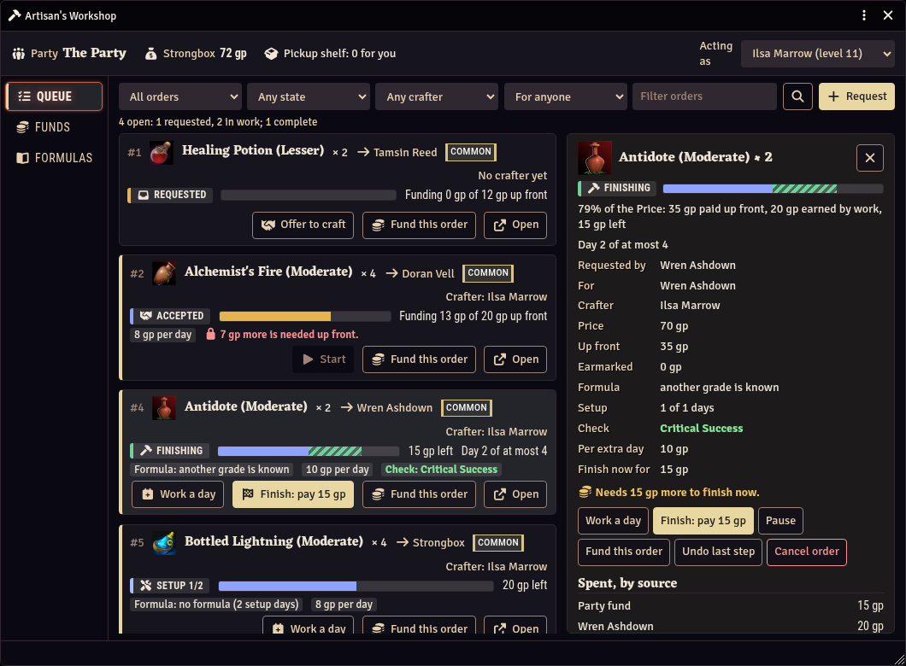
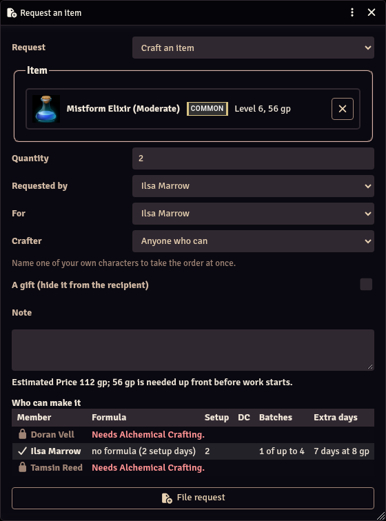
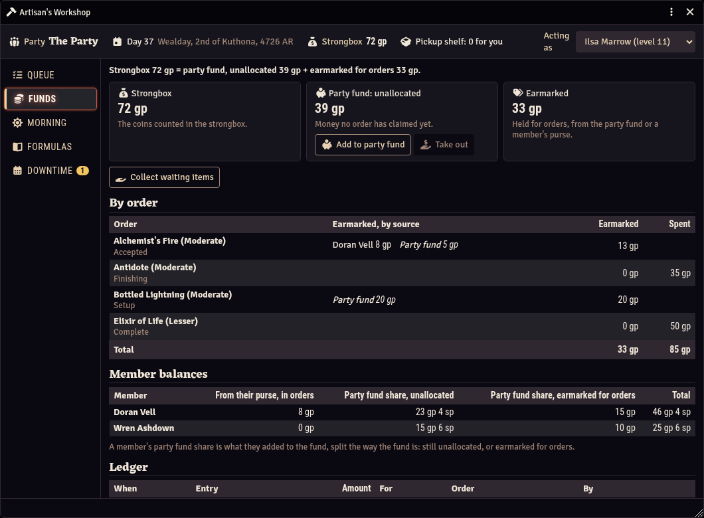
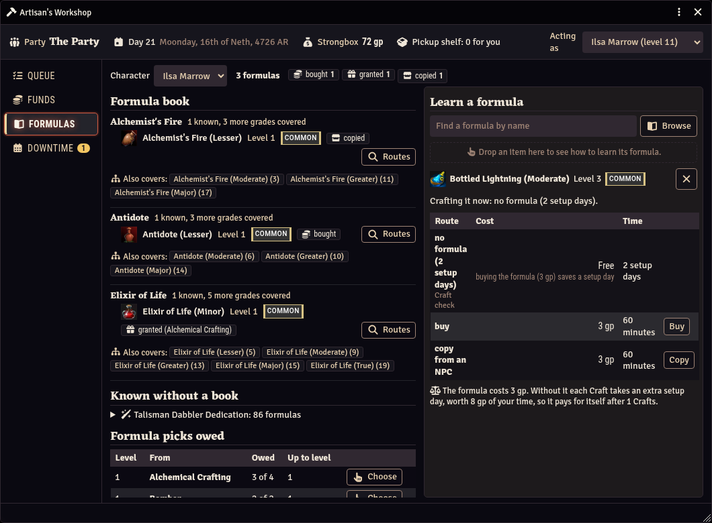
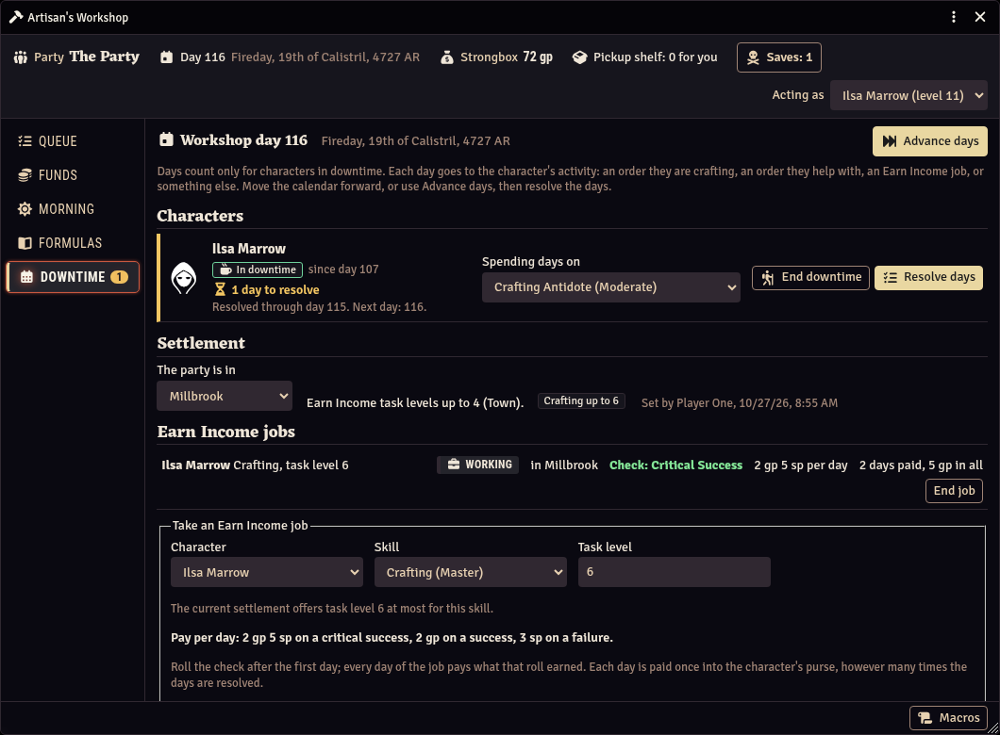
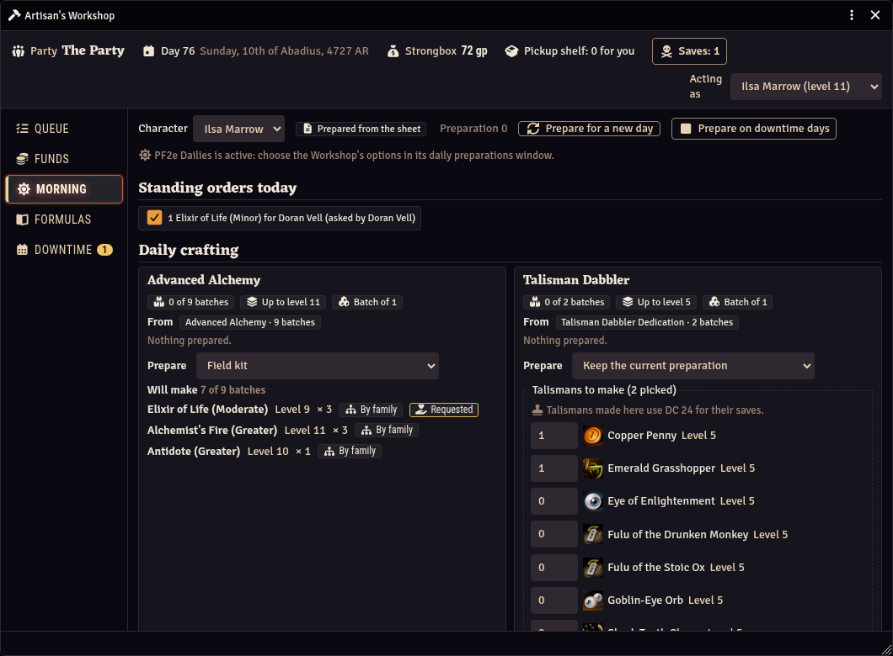
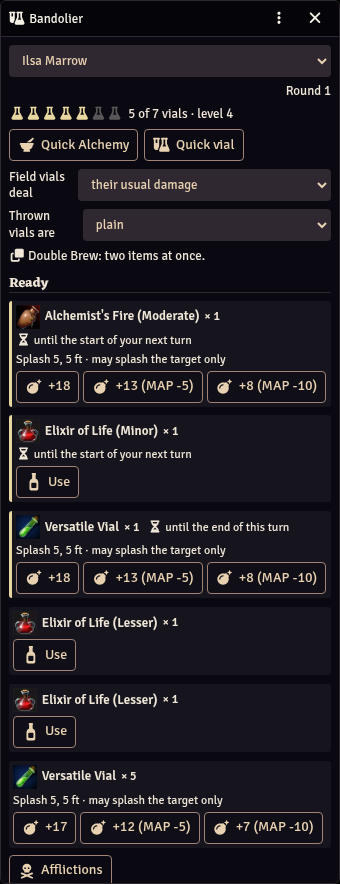
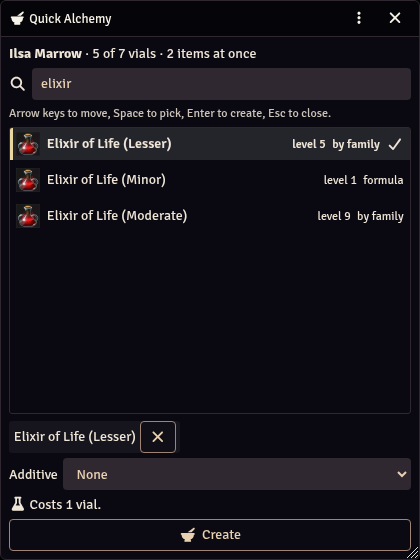
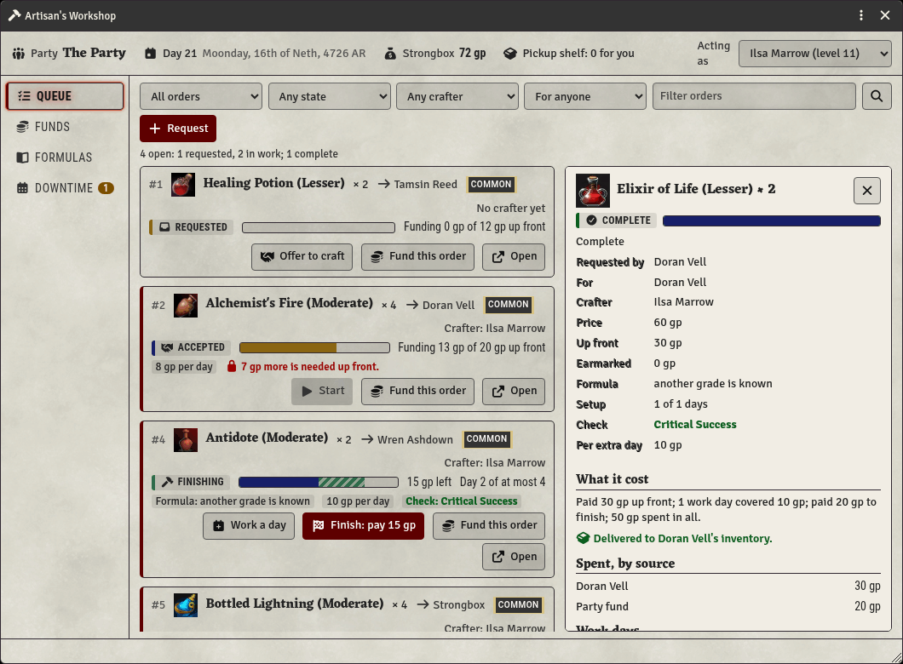

# Artisan's Workshop (PF2e)

A Foundry VTT module for the Pathfinder Second Edition system: one place to run an
alchemist or crafter, and the party that leans on them.

**Status: early development.** Nothing installable yet: the repository has the M0
scaffold (manifest, tooling, CI), the M1 rules core (pure crafting and Earn Income
rules with tests), the M2 storage and sync layer (the shared ledger and strongbox,
safe coin moves, claims, roster snapshots, purge) and the M3 rules registry and roll
wrapper (Craft and Earn Income checks rolled with the item's options and recorded once,
rerolls included), and the M4 Workshop window: the Queue and Funds tabs, the order lifecycle
from request to delivery, escrow and refunds, chat cards and the request form. Open it from
the "Workshop" button in the Actors directory or on the Party sheet, or with
`game.modules.get("pf2e-artisans-workshop").api.ui.open()`. The
specification is `DESIGN.md`; decisions land in `DECISIONS.md`.

## What it is for

- **A party crafting queue.** Party members request items; the crafter sees what
  is wanted, which formulas they have (and how they could get the missing ones),
  the materials and days each item needs, and how far along each one is. Everyone
  sees the queue and a progress bar per item.
- **Shared funding.** Party members put gold toward an item's materials, and the
  ledger remembers who paid for what.
- **Daily preparations.** Advanced Alchemy, talismans and other daily items, built
  to work alongside the PF2e system and pf2e-dailies rather than against them.
- **Rules coverage.** Feats, class features and gear that change crafting cost,
  time, batches or formulas are read from the character, not entered by hand.
- **Downtime.** Earn Income with Crafting, Cooking Lore or any other skill, paid
  straight to the earner; GMs set settlement task levels. Nothing waits on GM
  approval, and it works with no GM online.

Alchemy is the first crafting journey, not the only one: magic items and runes,
talismans, tattoos and snares are in scope.

## Screenshots

A demo party in a test world, taken by `npm run screenshots` (see Development). The wording in the window is draft
until 1.0: every string is rewritten before the first release, and these captures are taken again then.

\
*The Queue: every order with its state and progress, and the detail of one in its last days of work.*

\
*The request form: who in the party can make the item, how, and what it needs up front.*

\
*Funds: the strongbox as the party fund, unallocated and earmarked per order, with each member's share.*

\
*Formulas: a character's book by family, where each formula came from, and the ways to learn another.*

\
*Downtime: the workshop day, a character's days and what they go to, the party's settlement, and an Earn Income job with its pay.*

\
*Morning: a character's daily crafting by pool, a loadout's plan with an ally's standing order, and the talismans it can make today.*

\
*The Bandolier in an encounter: the vials, Quick Alchemy and quick vials, and what is ready, with how long it stays potent and pf2e's Strike buttons.*

\
*Quick Alchemy: what the alchemist can make now, by formula or family, picked from the keyboard, with what it costs in vials.*

\
*The Queue in the light theme, with a finished order's cost summary.*

## Compatibility

Targets the latest Foundry VTT release and the latest PF2e system release, Remaster
rules first.

## Development

No build step and no runtime dependencies: `npm` installs only ESLint and, for the live
harness, `playwright-core` (which downloads no browser). Use Node 24.13.1 or a later 24.x
(`DESIGN.md` 3.2); `npm ci` refuses any other.

```sh
npm ci
npm run lint             # ESLint (DESIGN.md 15.1), then tools/check-source.mjs
npm test                 # node --test over test/
npm run check:manifest   # module.json against the manifest policy (DESIGN.md 3.1, 16.3)
npm run check:assets     # no images, audio, video or fonts but the README screenshots (DESIGN.md 16.5)
npm run check:strings    # strings still waiting for the author's sign-off (DESIGN.md 16.4)
npm run check:strings:enforce   # the same, failing if any is left (stable releases)
npm run signoff -- --keys <key> [<key> ...]   # sign off strings the author has rewritten
npm run harness:live     # the sync scenarios in a running dev world (below)
npm run screenshots      # the README screenshots, from a running dev world (below)
npm run validate:registry -- --pf2e <checkout>   # the rules registry against a pf2e checkout
```

Every user-facing string lives in `lang/en.json` under `pf2e-artisans-workshop.` keys.
Write each key out in full in code and templates (`"pf2e-artisans-workshop.Queue.Title"`,
not built from `MODULE_ID`) and capitalise its first segment: that is how `npm run lint`
finds keys and checks they exist, and how it tells them from hook and query names, which
are lower case. CI (`.github/workflows/ci.yml`) runs all of the above, with the strings
gate in report mode.

Layout: `scripts/` is the shipped code (`module.mjs` is the entry); `lang/` holds the
strings and `lang/review/` their sign-off hashes; `tools/` holds the dev scripts and
`tools/harness/` the fixture actors, the sync scenarios and their live driver, neither
shipped; `test/` the tests. `scripts/logic/` is the rules engine (pure functions with no
Foundry or browser globals, so `node --test` imports it directly; tests in `test/logic/`)
and `scripts/data/` its numeric tables, each cited by book and page. `scripts/foundry/`
is the code that talks to Foundry (storage and sync so far), tested in `test/foundry/`
against the small fake of Foundry in `test/foundry/stubs.mjs`. `scripts/ui/` is the
Workshop window, its chat cards and entry points (M4), with its Handlebars templates in `templates/` (no literal text:
every word is a key) and its stylesheet in `styles/`; `scripts/logic/views.mjs` holds the window's view models as pure
functions. A later milestone adds `macros/` (copy-paste macros; the lint rules and key check already cover that folder).

Local Foundry harness: symlink the checkout into `Data/modules/`, enable the module in a
test world, and as GM run `await game.settings.set("pf2e-artisans-workshop", "dev", true)`
in the console, then reload. In a dev world any deprecation warning whose stack passes
through this module's files throws, even one raised inside pf2e, core or another module
that this module called (except Application V1's own warning, which pf2e's V1 check dialog
raises; `DESIGN.md` 15.1), and `game.modules.get("pf2e-artisans-workshop").dev.fixtures.create()`
builds the fixture actors of `DESIGN.md` 15.4 (`{ reset: true }` rebuilds them), marked in
`flags.world` so the module's purge leaves the marks alone. The sync
scenarios of `DESIGN.md` 15.3 load on every client of a dev world:
`game.modules.get("pf2e-artisans-workshop").dev.scenarios.list()` shows each step, and
`.run("3c", "pledge", { order: "test", cp: 120 })` runs one on that client. To check
the fixtures' compendium UUIDs and choice-set answers against a pf2e source checkout, run
`PF2E_SRC=<checkout> npm test`; the same run checks the rules registry (`scripts/data/registry.mjs`): every
entry's UUID, slug, type, remaster flag and the rule elements it relies on, and reports compendium items that mention
crafting, formulas, daily preparations or Earn Income but are in neither the registry nor its ignore list
(`npm run validate:registry`, `--enforce` to fail on them). CI runs both against the pinned pf2e release.

`npm run harness:live` runs those scenarios with every user at once
(`tools/harness/run-live.mjs`, plans in `tools/harness/live-plans.mjs`). It needs the dev
world running with the fixture actors built and users without passwords (Gamemaster,
Player One, Player Two; it creates an "Assistant GM" user), and a Chromium on the
machine; it then drives one headless browser context per user and device (a second tab
shares its device's context). Through the Foundry API it assigns Player One fixture 3 and
Player Two fixture 6 as owners and party members, and before every plan it deletes and
re-creates the shared documents and refills both purses, so use a world kept for testing.
Each scenario runs `--runs` times (default 2), then the behaviour checks (`--behaviours
all|none|<ids>`; `migration-lock` waits out the five-minute lock and takes about six
minutes, `slow-answer` holds two answers back 35 s each, `resume` drops Player One's
connection between a move's two requests and waits out the 60 s grace time twice, and
`cleric-fixture` rebuilds fixture 13 and fails if pf2e opens a choice prompt):

```sh
npm run harness:live -- --runs 2 --behaviours all --out /tmp/live     # everything
npm run harness:live -- --scenarios 3c --runs 1 --behaviours none --canvas
npm run harness:live -- --scenarios none --behaviours m4-lifecycle,m4-no-gm,m4-cancel,m4-double-delivery,m4-reroll-race,m4-shots,m4-ui --runs 1 --shots /tmp/m4-shots
npm run harness:live -- --scenarios none --behaviours m5-buy,m5-ally-copy,m5-pick,m5-jobs,m5-etch,m5-upgrade-transfer,m5-precious,m5-scroll,m5-fund,m5-services,m5-ui,m5-shots --runs 1 --shots /tmp/m5-shots
npm run harness:live -- --scenarios none --behaviours m6-clock,m6-wizard-gm,m6-wizard-players,m6-communal,m6-income,m6-settlement --runs 1
npm run harness:live -- --scenarios none --behaviours m7-morning,m7-expiry,m7-rest,m7-dailies,m7-standing,m7-affix,m7-shots --runs 1 --shots /tmp/m7-shots
npm run harness:live -- --scenarios none --behaviours m8-panel,m8-bandolier,m8-turn,m8-vials,m8-healing-bomb,m8-duct-tape,m8-use-best,m8-shots --runs 1 --shots /tmp/m8-shots
npm run harness:live -- --scenarios none --behaviours m8-hud,m8-bandolier,m8-panel --runs 1 --canvas
npm run harness:live -- --scenarios none --behaviours m8a-cloud,m8a-once,m8a-powerful,m8a-timing,m8a-forge,m8a-backends,m8a-panel,m8a-familiar,m8a-shots --runs 1 --shots /tmp/m8a-shots
npm run harness:live -- --scenarios none --behaviours m8a-strike --runs 1 --canvas
npm run harness:live -- --scenarios none --behaviours m9-tattoo,m9-simple,m9-graft,m9-fulu-missive,m9-staff,m9-snares,m9-gadget,m9-shots --runs 1 --shots /tmp/m9-shots
```

The registry check also reads every pf2e item with stages, onset or a maximum duration as an affliction (`DESIGN.md`
8.10.2): each must read cleanly, have an override in `scripts/data/afflictions.mjs`, or be on its ignore list, or the run
fails. `--affliction-baseline <json>` (an earlier run's `--json` output) lists the items whose reading changed between two
pf2e releases.

The M4 behaviours run the order lifecycle with a GM and two players (`m4-lifecycle`), with two players and no GM, the
recipient offline at the finish (`m4-no-gm`), a cancel with refunds (`m4-cancel`), the double-delivery race
(`m4-double-delivery`, which waits out the 60 s grace time) and the reroll-against-settlement race (`m4-reroll-race`);
`m4-shots` seeds orders and saves screenshots of the Queue and Funds tabs as the GM and as a player at 1440x900 and
1024x768, dark and light, into `--shots` (default `<out>/shots`); `m4-ui` drives the window as Player One with real
clicks and keys (tabs, both searches, focus through a refresh, the narrow tier, a detached Workshop, the chat cards
after a reload). The M5 behaviours (DESIGN 10.11) need the wizard
fixture (7) built besides the two player characters; each starts by taking back the items earlier M5 plans gave the
characters (marked `flags.world.pf2e-artisans-workshop-m5`) and putting their formula books back. `m5-shots` saves the
Formulas tab as the GM (showing Player One's alchemist) and as Player One, and the Queue with a handed-over item and a
service, at 1440x900 and 1024x768 in both schemes. A world launched before `module.json` named
`styles/workshop.css` serves pages without it; the driver then adds it to each page and says so in `results.json`
(`styleAdded`).

The M6 behaviours (DESIGN 10.12) move the world clock forward (never back), so run them in the dev world only.
`m6-clock` checks the one prompt per day to the owner's client (the GM's while the player is away, the player's at
login); `m6-wizard-gm` and `m6-wizard-players` drive the Advance days window step by step, with a GM moving the clock and
with players only; `m6-communal` gives Player One's alchemist Communal Crafting (marked like M5's items) for Player Two to
help; `m6-income` pays an Earn Income job from Player Two on two devices; `m6-settlement` caps a job's task level.

The M7 behaviours (DESIGN 10.13) prepare Player One's bomber (Talisman Dabbler) through pf2e's own crafting methods
(`m7-morning`: a loadout by family, virtual talismans, the stamps), hand an infused elixir to Player Two and rest
(`m7-expiry`: it goes inert on Player Two's client; 24 hours later the next batch does too), rest the party with
pf2e-dailies off (`m7-rest`: one Morning prompt, on the right client) and on (`m7-dailies`: the plan turns pf2e-dailies and
lib-wrapper on in the world's module configuration, reloads every page, drives pf2e-dailies' own window to choose a
loadout in the Workshop's row, and puts the configuration back), deliver a standing order with no GM (`m7-standing`),
affix talismans with and without Talismanic Sage (`m7-affix`), and photograph the Morning tab (`m7-shots`). Items they
give are marked `flags.world.pf2e-artisans-workshop-m7`; each plan puts the characters' formula books and prepared lists
back first.

The M8 behaviours (DESIGN 10.14) use Player One's bomber (level 11: Double Brew, Alchemical Expertise, the field discovery,
Advanced Vials). Without a canvas: `m8-panel` lists what Quick Alchemy makes, makes it through pf2e (one vial; refused at 0;
two with Double Brew) and drives the panel with real keys; `m8-bandolier` reads the vial pips, makes a quick vial (the vial
count unchanged) and throws it through pf2e's own Strike, and checks the window reopens where it was dragged; `m8-turn` runs
a token-less encounter of the fighter and the bomber and checks each Quick Alchemy item ends at its turn, on the client of
whoever holds it, and at the encounter's end; `m8-vials` turns vial gathering on, moves the clock and has two clients gather
at the cap; `m8-healing-bomb` throws a Healing Bomb at Player Two's hurt fighter; `m8-duct-tape` stands Duct Tape in on every
client (a stand-in package entry when it is not installed); `m8-use-best` uses Player Two's potions in order; `m8-shots`
photographs the Bandolier and the panel. `m8-hud` needs `--canvas` and a scene with Player One's bomber token on it (it says
it was skipped without one): the alchemy palette in the token HUD, opened by core's own palette toggle, kept open while the
token moves. Items and feats they give, and the encounters they make, are marked `flags.world.pf2e-artisans-workshop-m8`;
each plan takes them back and refills the vials first.

`npm run screenshots` (`tools/harness/screenshots.mjs`, DESIGN.md 17.1) takes the README's screenshots in the same dev
world, through the same driver. It copies four fixture actors into a demo party with generic names (Player One plays the
alchemist, Player Two the fighter), makes them the party and the players' characters, stages orders in every state, money
in the party fund, three formulas and downtime (a settlement, two days of an Earn Income job, a day to resolve on an
order; the GM moves the world clock forward, so use the dev world), and captures the Workshop window cropped to its frame
as Player One at 1440x900: the Queue with an order's detail, the request form, Funds, Formulas, Downtime and Morning (a
loadout and a standing order staged for the alchemist) in the dark theme, and the Queue in the light one.
Each capture is checked for raw i18n keys, fixture names and overflowing boxes, compressed with ImageMagick's `magick`
when it is installed (to 256 colours only if it would be over 400 KiB), and written to `docs/screenshots/` (`--out` for
elsewhere; `--results` for the run's JSON). Then it gives the party and the users their own characters back, deletes the
demo actors and the run's chat messages, and resets the shared documents as `harness:live` does. The captures show the
checkout the server runs. `docs/screenshots/` is the only place the asset check allows images (PNG, at most 400 KiB
each), and the release zip leaves `docs/` out.

Options: `--shots` (where screenshots go), `--url` (default `http://localhost:30000`), `--chromium` (the browser binary; on
Arch the default is `/usr/lib/chromium/chromium`, behind the `/usr/bin/chromium` launcher
that adds the desktop's flags), `--headed`, `--canvas` (pages load the game canvas;
without it a player's client throws in core's `Actor#_onUpdate` whenever an actor's
ownership changes, so that client never runs its `updateActor` hooks, as at a table where
a player turned the canvas off; the module copes, and `--canvas` covers the usual case). It prints each
check, exits non-zero if any fails, and writes every step's JSON result, every check,
each page's console errors, notifications and dry-run hooks, and any slow answer from the
server to `<out>/results.json` (by default in a new folder under the system's temporary
directory). At the end it resets the world once more (switch on, fresh shared documents).

## License

Code is MIT (see `LICENSE`). This is unofficial fan content, not affiliated with or
endorsed by Paizo Inc.; the content-licensing notice will be finalised before the
first release.
